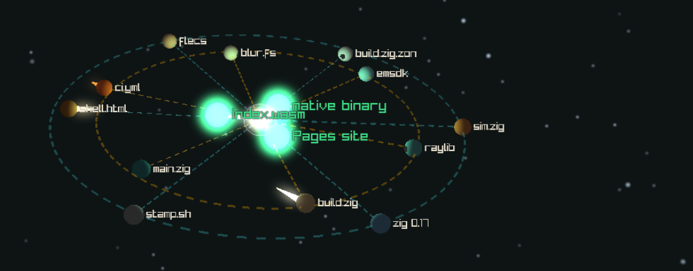

# zig-orbit-mindmap

[](https://ziglang.org/download/)
[](https://dynnamitt.github.io/zig-orbit-mindmap/)
[](https://emscripten.org/)



A 3D star system as an IPO (input → process → output) mind map, in Zig 0.17 with
[raylib-zig](https://github.com/raylib-zig/raylib-zig) for window + rendering and
[zflecs](https://github.com/zig-gamedev/zflecs) for ECS. Both come in as Zig packages pinned in `build.zig.zon`.

- **Process:** the warm-white mother star, in the middle.
- **Outputs:** phosphor-green child stars, tied to her by glowing cords.
- **Inputs:** planets on elliptical orbits around the cluster's centre of gravity, pulled by every star. Each has a dashed line to the mother's ring, in the colour of its orbit ring (amber inner, cyan outer) and brighter toward the centre, and a thruster that fires to bring it back to its slot on the ring.
- **Backdrop:** a shader starfield that turns with the camera.

Drag (or one finger) to orbit the camera; scroll (or pinch) to zoom. The − and + buttons at the top left remove and add outputs: with one or two left, the stars switch to a "waiting" dance. The window resizes freely, and
in the browser it fills the viewport in either orientation.

```sh
zig build test               # headless ECS unit tests
zig build run                # launch (Linux needs X11/GL dev headers, see .github/workflows/ci.yml)
zig build run -- --portrait  # start in a portrait window
zig build -Dtarget=wasm32-emscripten -Doptimize=ReleaseSmall   # browser build → zig-out/web/
```

## Note to self: perf, Zig vs Rust (wasm size)

This repo against [hex-terrain](https://github.com/dynnamitt/hex-terrain) (Rust, Bevy 0.18), measured 2026-11-22.
MB = 10⁶ bytes; gzip is level 9.

| Build | wasm | wasm, gzip | wasm + JS, gzip | vs Zig, gzip |
|---|--:|--:|--:|--:|
| **Zig**, deployed at `850bb04` (`ReleaseSmall`) | 0.47 MB | 0.21 MB | 0.25 MB | 1× |
| **Rust**, `make wasm` as it is (`--release`, `7254558`) | 70.93 MB | 14.35 MB | 14.37 MB | 57× |
| Rust, its unused `wasm-release` profile | 65.43 MB | 13.05 MB | 13.06 MB | 52× |
| Rust, that profile without function names | 40.78 MB | 9.19 MB | 9.21 MB | 36× |
| Rust, all size flags¹ | 18.65 MB | 6.48 MB | 6.49 MB | 26× |

¹ `opt-level="z"`, fat LTO, 1 codegen unit, `strip=true`, `wasm-opt -Oz`.

- **Names first:** 20-25 MB of the Rust wasm is function names (`wasm-bindgen --remove-name-section`).
  `wasm-opt` shrinks the file, but changes the gzipped download by only about 2% once names are gone.
- **Small can be slower:** the `wasm-release` profile (`opt-level="s"`) took about 6% more CPU per frame than
  `--release` (Chromium, RTX 3060 Ti, median of 5 runs). The smallest build was not timed.
- **Then the stack:** the remaining 26× is not Zig vs Rust as languages. It is raylib + Flecs (both C, Flecs
  cut down to the add-ons used here) vs Bevy (wgpu, PBR, egui, …), and two different apps.
- **Not compared:** Zig's frame time against Rust's, startup, memory.

## Updating deps

```sh
zig fetch --save git+https://github.com/raylib-zig/raylib-zig#<commit>
zig fetch --save git+https://github.com/zig-gamedev/zflecs#<commit>
```

Live demo, redeployed from `main` on every push: https://dynnamitt.github.io/zig-orbit-mindmap/
